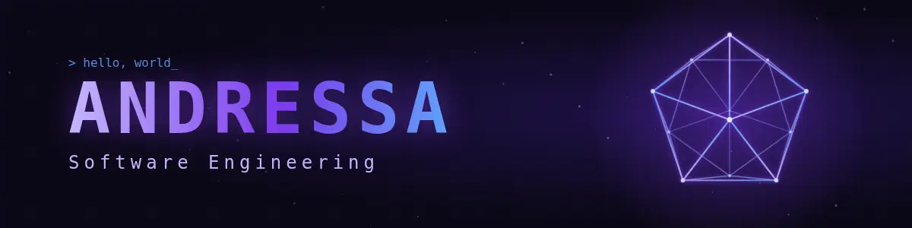

<div align="center">



<!-- After exporting, replace with:  -->

# Hi, I'm Andressa Pedrosa da Silva 👋

**Software Engineering student · Full-Stack Developer**


</div>

---

## 💜 About Me

I'm a Software Engineering student with professional experience in **Full-Stack development**, building **web systems, internal tools and process automation**.

- 🌐 Web development
- 🤖 Artificial intelligence
- ⚙️ Automation
- 🎮 Game development

## 🛠️ Tech Stack

**Languages**<br>


**Frontend**<br>


**Backend**<br>


**Database**<br>


**Tools**<br>


## 🚀 Featured Projects

<!-- Replace each placeholder with a real repository (change the repo name below). -->
<table>
  <tr>
    <td width="50%">
      <a href="https://github.com/dev.andressa/YOUR-PROJECT-1"><b>Project 1</b></a><br>
      <sub>Add a short description of the project here.</sub>
    </td>
    <td width="50%">
      <a href="https://github.com/dev.andressa/YOUR-PROJECT-2"><b>Project 2</b></a><br>
      <sub>Add a short description of the project here.</sub>
    </td>
  </tr>
</table>

Or use the pinned repositories card (set `repo=` to your own repository):

```md
[](https://github.com/dev.andressa/REPO_NAME)
```

## 📊 GitHub Stats

<div align="center">


</div>

## 🔗 Links

<!-- Edit the URLs below: only keep the links you want to show. -->
[](https://github.com/dev.andressa)
[](https://www.linkedin.com/in/YOUR-LINKEDIN)
[](mailto:YOUR-EMAIL)
[](https://YOUR-PORTFOLIO-URL)

---

## 🎬 Animated Banner

```
assets/
├── banner.svg          # animated SVG used in this README
└── banner/
    ├── index.html      # standalone page (1200×300)
    ├── banner.css
    └── banner.js       # pseudo-3D rotating icosahedron (Canvas, no dependencies)
scripts/export-frames.mjs
```

**Run / preview:** open `assets/banner/index.html` in a browser, or serve it:

```bash
python3 -m http.server 8000   # then open http://localhost:8000/assets/banner/
```

**Export as GIF / WebP:** the animation is deterministic and loops every 8 s. Use `?t=SECONDS` to view a single frame.

```bash
npm i --no-save playwright && npx playwright install chromium
node scripts/export-frames.mjs 30          # PNG frames -> assets/banner/frames/

ffmpeg -framerate 30 -i assets/banner/frames/frame-%04d.png -loop 0 -c:v libwebp -lossless 0 -q:v 80 assets/banner/banner.webp
ffmpeg -framerate 30 -i assets/banner/frames/frame-%04d.png -vf "split[a][b];[a]palettegen[p];[b][p]paletteuse" -loop 0 assets/banner/banner.gif
```

Then point the `` at the top of this README to the exported file.
